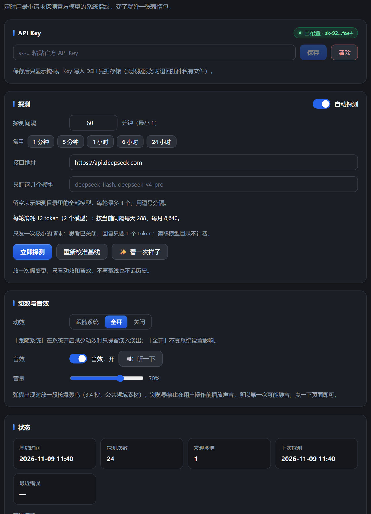
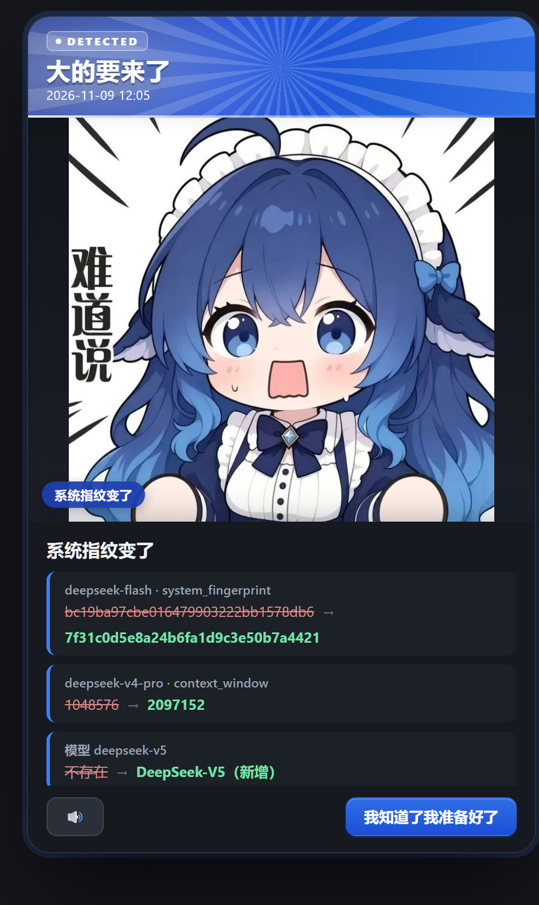

# dsh-big-coming · 大的要来了

DeepSeek Harness 插件：定时用最小请求探测官方模型是否发生变化，变了就弹一张表情包，
下面列出具体哪里变了。

> 一个玩笑，但探测是真的：它盯着的是 `system_fingerprint`、返回的 `model` 字段、
> 响应信封的键集合、模型目录的元数据，以及**固定输入的 `prompt_tokens`**（分词器指纹）。

## 截图

**设置页**



**发现变化时**



## 它做什么

每一轮：

1. `GET /models` —— 模型目录。比较 `name`、`context_window`、`max_output_tokens`、
   `input_modalities`、`output_modalities`、`effort`、`api_capabilities`，以及模型的增删。
2. `POST /chat/completions`，`max_tokens: 1`、`thinking: {"type": "disabled"}`，
   每个受关注模型一次。比较 `system_fingerprint`、返回的 `model` 字段、响应信封的键集合、
   以及 `prompt_tokens`。

任一项和基线不一致，就抛出一个事件：随机一张表情包，加一张变更明细表。

## 装

```sh
dsh plugin add dsh-big-coming
```

或者从源码：

```sh
dsh plugin add https://github.com/Sumcam-L/dsh-big-coming
```

装好后在 **设置 → 大的要来了** 里填 API Key。

## 设置

| 项 | 说明 |
| --- | --- |
| API Key | 写入 DSH 凭据存储（无凭据服务时退回 `~/.dsh/dsh-big-coming/api-key.txt`）。界面上只显示掩码。 |
| 探测间隔 | 分钟，最小 1，默认 60。 |
| 自动探测 | 关掉就只在手动点「立即探测」时跑。 |
| 接口地址 | 默认 `https://api.deepseek.com`，可指向兼容端点。 |
| 只盯这几个模型 | 逗号分隔。留空表示探测目录里的全部模型，每轮最多 4 个。 |
| 立即探测 | 跑一轮，有变化就弹窗。 |
| 重新校准基线 | 把当前状态记为基线，不弹窗。 |
| ✨ 看一次样子 | 放一次**假**变更，只看动效和音效：不写基线、不记历史、不动计数。 |
| token 成本 | 实时显示每轮 / 每天 / 每月的消耗，随间隔和关注模型数自动变化。 |

### 动效与音效

| 项 | 说明 |
| --- | --- |
| 动效 | **全开**（默认）忽略系统「减少动效」设置；**跟随系统**在系统要求时只保留淡入淡出；**关闭**完全静止。 |
| 音效 | 弹窗出现时放一段核爆轰鸣。 |
| 音量 | 0–100%，松手即保存。 |
| 听一下 | 放一次完整的音效。浏览器禁止在用户操作前发声，所以第一次可能静音——点一下页面即可。 |

**音效来源**：Internet Archive 的
[SSE Library: EXPLOSIONS](https://archive.org/details/SSE_Library_EXPLOSIONS)
（USC Cinema / Sunset Editorial 音效库），**CC0 公共领域**。取 *Atomic bomb explosion
then rumble* 一段，裁到 3.4 秒，做了 45Hz 次低频增强、压缩和淡出，最终 48 KB。

## 一次探测花多少 token

**每个模型 6 个 token**（5 prompt + 1 completion），两个模型一轮 12 个。读取模型目录
不产生 token，也不计费。

关闭思考是关键：`deepseek-v4-pro` 默认 `effort` 是 `high`，不关思考时它要先输出一段
推理，prompt 从 5 涨到 84；`deepseek-flash` 则从 5 涨到 31。关闭后两者都回到 5，
而 `system_fingerprint`、`model` 字段和响应信封结构完全不变，探测看的东西一个没少。

按 60 分钟间隔算：每天 288 token，每月约 8,640 token。设置页会直接显示这个数字。

## 会检测分词器吗

会。`prompt_tokens` 是一个**固定输入的免费指纹**：同一段文字，分词器变了，切出的 token
数就会变，而 `system_fingerprint` 不变时它可能照样变。所以每轮都记录这个数字：

- 探针文字固定为 `hi`（成本不变）
- 首次记录时把这段文字一起存进基线
- 之后的每轮比对：**同一个模型、同一段文字，token 数不一样 → 报「分词器变了」**

为什么要同时存文字：老基线没有这个字段，如果不比对文字，升级插件那一刻就会误报一次。

实测（`deepseek-flash`，同一输入连测 5 次都是 5）：

| 输入 | prompt_tokens |
| --- | --- |
| `hi` | 5 |
| `hello world` | 6 |
| `hello world hello world` | 8 |
| `The quick brown fox jumps over the lazy dog.` | 14 |
| 中文 12 字 | 12 |

## 变更长什么样

只有「和基线不一样」才叫变更。首次探测或点「重新校准基线」时只记录基线，不弹窗；
「看一次样子」不碰基线也不写历史。

变更按种类给出标题：**分词器变了** / **系统指纹变了** / **响应结构变了** /
**新模型登场** / **模型下架了** / **模型参数变了**。

## 关于配色

这个插件不假设主题的 `button` 规则可用：皮肤主题（比如 `dsh-claude-style`）会重定义整张
`--dsw-alias-*` 调色板，一旦背景色和文字色落到同一族里，按钮就会「看不见」。所以：

- 每个控件**同时**钉死自己的背景和前景，并带有字面量兜底色，不依赖继承；
- 实心按钮用渐变，并保证最亮那一档配白字仍达到 WCAG AA（4.5:1）；
- 深色主题通过 `data-ds-dark-theme` 匹配，宿主的每个主题都设这个属性；
- 整套 CSS 由插件自己安装一次，不挂在任何一个组件上——否则设置页和弹窗会互相等对方先渲染。

## 数据文件

| 路径 | 内容 |
| --- | --- |
| `~/.dsh/dsh-big-coming/state.json` | 基线、历史、统计、设置 |
| `~/.dsh/dsh-big-coming/api-key.txt` | 仅在没有凭据服务时使用 |

历史保留最近 60 条。

## 已知限制

- 每轮最多探测 4 个模型（`MAX_MODELS_PER_CYCLE`）。
- 变更判定基于「和基线不同」，所以官方**改回**旧指纹也算一次变更。
- 只能探测目录里存在的模型。
- 浏览器不允许在用户交互前播放声音，第一次弹窗可能静音。

## License

MIT。表情包与音效素材的使用见上文各自说明。
